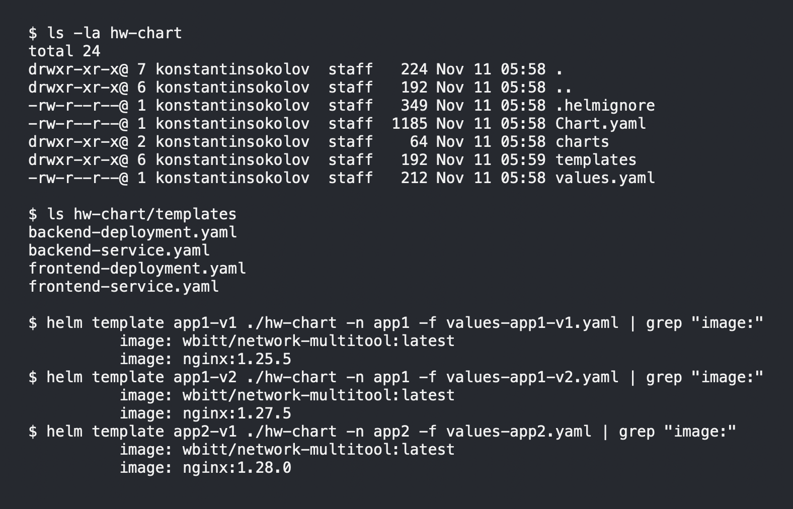
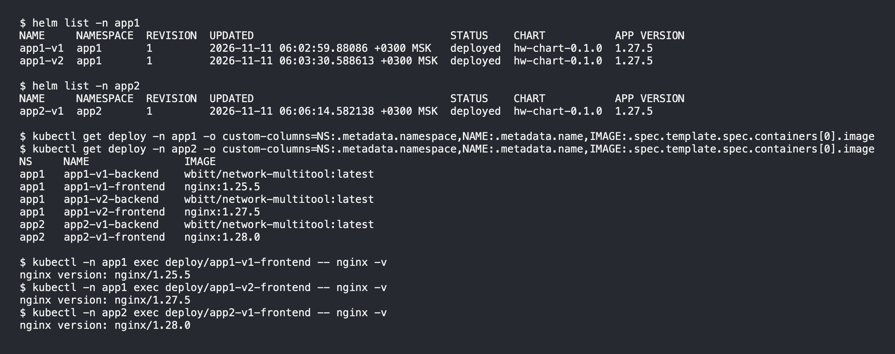

# Домашнее задание к занятию «Helm»

### Цель задания

В тестовой среде Kubernetes необходимо установить и обновить приложения с помощью Helm.

------

### Чеклист готовности к домашнему заданию

1. Установленное k8s-решение, например, MicroK8S.
2. Установленный локальный kubectl.
3. Установленный локальный Helm.
4. Редактор YAML-файлов с подключенным репозиторием GitHub.

------

### Инструменты и дополнительные материалы, которые пригодятся для выполнения задания

1. [Инструкция](https://helm.sh/docs/intro/install/) по установке Helm. [Helm completion](https://helm.sh/docs/helm/helm_completion/).

------

### Задание 1. Подготовить Helm-чарт для приложения

1. Необходимо упаковать приложение в чарт для деплоя в разные окружения. 
2. Каждый компонент приложения деплоится отдельным deployment’ом или statefulset’ом.
3. В переменных чарта измените образ приложения для изменения версии.

```bash
export KUBECONFIG=~/.kube/config-microk8s
cd task01
helm create hw-chart
ls -la hw-chart 

```

### Решение

Чарт [hw-chart](./task01/hw-chart). Два компонента, каждый своим Deployment и Service: frontend (`nginx`) и backend (`wbitt/network-multitool`). Образ и тег берутся из values, шаблоны для смены версии не правятся. Имена и селекторы завязаны на `{{ .Release.Name }}`, namespace — на `{{ .Release.Namespace }}`, иначе второй релиз в том же namespace затрёт первый.

Файлы окружений, в каждом свой тег nginx:

- [values-app1-v1.yaml](./task01/values-app1-v1.yaml) — `nginx:1.25.5`
- [values-app1-v2.yaml](./task01/values-app1-v2.yaml) — `nginx:1.27.5`
- [values-app2.yaml](./task01/values-app2.yaml) — `nginx:1.28.0`

```bash
cd task01
ls -la hw-chart
# total 24
# drwxr-xr-x@ 7 konstantinsokolov  staff   224 Nov 11 05:58 .
# drwxr-xr-x@ 6 konstantinsokolov  staff   192 Nov 11 05:58 ..
# -rw-r--r--@ 1 konstantinsokolov  staff   349 Nov 11 05:58 .helmignore
# -rw-r--r--@ 1 konstantinsokolov  staff  1185 Nov 11 05:58 Chart.yaml
# drwxr-xr-x@ 2 konstantinsokolov  staff    64 Nov 11 05:58 charts
# drwxr-xr-x@ 6 konstantinsokolov  staff   192 Nov 11 05:59 templates
# -rw-r--r--@ 1 konstantinsokolov  staff   212 Nov 11 05:58 values.yaml

ls hw-chart/templates
# backend-deployment.yaml
# backend-service.yaml
# frontend-deployment.yaml
# frontend-service.yaml

helm template app1-v1 ./hw-chart -n app1 -f values-app1-v1.yaml | grep 'image:'
#           image: wbitt/network-multitool:latest
#           image: nginx:1.25.5
helm template app1-v2 ./hw-chart -n app1 -f values-app1-v2.yaml | grep 'image:'
#           image: wbitt/network-multitool:latest
#           image: nginx:1.27.5
helm template app2-v1 ./hw-chart -n app2 -f values-app2.yaml | grep 'image:'
#           image: wbitt/network-multitool:latest
#           image: nginx:1.28.0
```



------
### Задание 2. Запустить две версии в разных неймспейсах

1. Подготовив чарт, необходимо его проверить. Запуститe несколько копий приложения.
2. Одну версию в namespace=app1, вторую версию в том же неймспейсе, третью версию в namespace=app2.
3. Продемонстрируйте результат.

### Решение

Три релиза одного чарта. `app1-v1` и `app1-v2` в namespace `app1` (разные теги nginx), `app2-v1` в namespace `app2`.

```bash
export KUBECONFIG=~/.kube/config-microk8s
cd task01

helm upgrade -i app1-v1 ./hw-chart -n app1 --create-namespace -f values-app1-v1.yaml
helm upgrade -i app1-v2 ./hw-chart -n app1 -f values-app1-v2.yaml
helm upgrade -i app2-v1 ./hw-chart -n app2 --create-namespace -f values-app2.yaml

helm list -n app1
# NAME     NAMESPACE  REVISION  UPDATED                               STATUS    CHART           APP VERSION
# app1-v1  app1       1         2026-11-11 06:02:59.88086 +0300 MSK   deployed  hw-chart-0.1.0  1.27.5
# app1-v2  app1       1         2026-11-11 06:03:30.588613 +0300 MSK  deployed  hw-chart-0.1.0  1.27.5

helm list -n app2
# NAME     NAMESPACE  REVISION  UPDATED                               STATUS    CHART           APP VERSION
# app2-v1  app2       1         2026-11-11 06:06:14.582138 +0300 MSK  deployed  hw-chart-0.1.0  1.27.5

kubectl get deploy -n app1 -o custom-columns=NS:.metadata.namespace,NAME:.metadata.name,IMAGE:.spec.template.spec.containers[0].image
kubectl get deploy -n app2 -o custom-columns=NS:.metadata.namespace,NAME:.metadata.name,IMAGE:.spec.template.spec.containers[0].image
# NS     NAME               IMAGE
# app1   app1-v1-backend    wbitt/network-multitool:latest
# app1   app1-v1-frontend   nginx:1.25.5
# app1   app1-v2-backend    wbitt/network-multitool:latest
# app1   app1-v2-frontend   nginx:1.27.5
# app2   app2-v1-backend    wbitt/network-multitool:latest
# app2   app2-v1-frontend   nginx:1.28.0

kubectl -n app1 exec deploy/app1-v1-frontend -- nginx -v
# nginx version: nginx/1.25.5
kubectl -n app1 exec deploy/app1-v2-frontend -- nginx -v
# nginx version: nginx/1.27.5
kubectl -n app2 exec deploy/app2-v1-frontend -- nginx -v
# nginx version: nginx/1.28.0
```



### Правила приёма работы

1. Домашняя работа оформляется в своём Git репозитории в файле README.md. Выполненное домашнее задание пришлите ссылкой на .md-файл в вашем репозитории.
2. Файл README.md должен содержать скриншоты вывода необходимых команд `kubectl`, `helm`, а также скриншоты результатов.
3. Репозиторий должен содержать тексты манифестов или ссылки на них в файле README.md.
